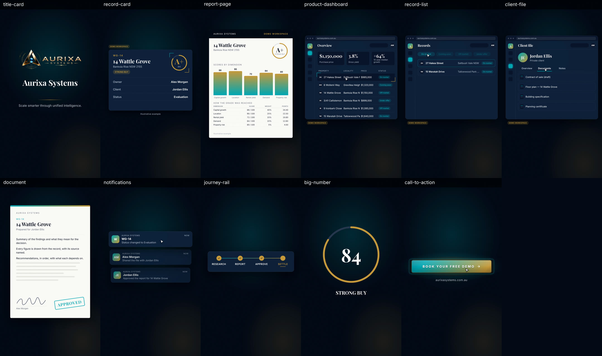

# Aurixa Reels 2 and 3: the plan

How the next two reels are made: Reel 1's method, now mostly the studio's own features, what each reel needs from the
client, and the checks each must pass before anyone sees it.

Written 23 October 2026. It builds on [Reel 1's handover](../aurixa-reel-1/HANDOVER.md), whose method and numbers it
doesn't repeat.

## At a glance

|              |                                                                                                                                                                                                                                    |
| ------------ | ---------------------------------------------------------------------------------------------------------------------------------------------------------------------------------------------------------------------------------- |
| What         | Two 9:16 reels (1080 x 1920, 30 fps) for Aurixa Systems, made as Reel 1 was: the product is the cast, every screen built from its code with a fictional record                                                                     |
| Kept         | The format, Reel 1's voice, the brand read from its code, the fictional record, captions in the brand's type, music paced on its bars, -14 LUFS, a master measured against its lossless reference                                  |
| Enhanced     | The client's 14 notes on Reel 1 as the standard from the first frame; the studio's features where Reel 1 needed one-off scripts; music with a clear licence; finals drawn in stretches across workers; reviews pinned to the frame |
| Ready now    | The media worker with every feature live; Aurixa's production stylesheet and demo record in its brand kit; Reel 1's voice as a brand voice; Reel 1's scripts for the bespoke screens                                               |
| Needed first | Each reel's concept, script and music decision from the client (sections 3 and 4)                                                                                                                                                  |

## 1. Ready now

Checked on 23 October 2026:

- **The media worker is live with every feature.** `xeno-media-worker` on Fly runs the image tested on main and reports
  all 29 of its features: compositions (motion graphics drawn in its browser), brand captions and their panel,
  mastering, stems and the mix report, voice pauses, music pieces, `align_take`, `clean_plate`, `redact_image`,
  measured renders and review sheets among them. Transitions keep every frame on its FFmpeg (5.1), and the slides draw
  only the picture.
- **Every feature's tables exist.** Migrations 0027 to 0036 are applied to the live database.
- **Aurixa's brand kit carries its production stylesheet.** That is 27 roles, each with the repository, file and line it
  came from:
  - the colours: ground #040B16, signature gold #C89B3C, accent cyan #00A8B5, ink #FFFFFF on the ground at 19.7:1;
  - the type: Playfair Display, Inter and JetBrains Mono;
  - the products' radii, shadows, glass and curves.

  The 30 places where the four repositories disagree are each decided in writing. Every check on the Brand page passes.

- **Aurixa's brand kit carries its demo record.** Every product screen's motion graphic reads it, so no reel can show a
  real client. It holds:
  - 14 Wattle Grove, Banksia Rise NSW 2155, graded A+ (84, STRONG BUY);
  - Alex Morgan, the buyer's agent, and Jordan Ellis, the private client;
  - the property team, the matter's four documents and twelve listings;
  - how the grade was reached, which sums to the 84.
- **Reel 1's voice is the studio's brand voice 0c84bc60.** It is ElevenLabs' "Gabby – Soft Young Australian" on
  `eleven_v4` (stability 0.5, similarity 0.75, style 0.3, speed 1.0), the voice and settings of Reel 1's master
  voiceover.
- **The studio makes music.** Eleven Music v2.5 tracks are made in the studio, and Openverse tracks can be imported
  with their licences.
- **Thirteen motion graphics draw in Aurixa's kit.** The eleven below need no pictures; the other two (a product
  window, pages running past) take screenshots. At final quality the brand's colours come out exact in the lossless
  master and within CIEDE2000 0.37 in the H.264 copy.

## 2. Similar, and enhanced

**Kept.** Every rule in the handover's section 1.6 holds unchanged:

- real client data never appears;
- nothing is fabricated as a result, and anything modelled carries the illustrative-example label;
- every value comes from the brand's code;
- the logo is the supplied file;
- the voice is never stretched;
- every cut sits on the frame grid and the music's;
- captions are the script's words;
- the render is deterministic, and nothing ships unmeasured.

**Enhanced.**

1. **The client's notes on Reel 1 are the standard from the start**, not a third cut:
   - a captivating opening;
   - a grade or figure that lands;
   - report pages as charts;
   - room to breathe;
   - no repeated screens, and one portal at a time;
   - a logo that leaps out;
   - a living call to action;
   - a closing card with a punch;
   - music under it all.
2. **The studio does what Reel 1's one-off scripts did** (section 5). Storyboards are timed from the voice, music is
   fitted on its bars, captions are word by word in the brand's type, and the mix comes with a report and stems. Every
   render is measured, reviews are pinned to the frame, and the master is exported in one encode.
3. **Reel 1's problems are designed out** (handover section 1.8):
   - finals are drawn in stretches on every worker, so no render waits on one machine or one session's limit;
   - the first frame, which is the thumbnail, is looked at at Gate 3;
   - caption panels follow the picture's lightness;
   - layout screenshots are redacted and refused in a frame.
4. **The music has a clear licence.** Either it is made in the studio, or it is a licensed track whose licence is
   confirmed and recorded in the ledger before public use. Reel 1's _National Treasures_ is still unconfirmed for
   public use.
5. **The three reels read as a series.** They share the opening and closing language (the logo's leap, the living call
   to action, the title card) and the demo record's people, so one reel can hand on to the next.

## 3. The concepts (the client's to choose)

Each concept takes its words from Aurixa's own site and its screens from the product's code at step 4, as Reel 1's
did. None retells Reel 1's story, which took one property through the Compass and the Financial Analysis to the free
trial.

| Concept                        | In the site's words                                                                                                                                                                                                                                                           | The story                                                                                                                                                                                                                            | From the demo record                                                                   |
| ------------------------------ | ----------------------------------------------------------------------------------------------------------------------------------------------------------------------------------------------------------------------------------------------------------------------------- | ------------------------------------------------------------------------------------------------------------------------------------------------------------------------------------------------------------------------------------ | -------------------------------------------------------------------------------------- |
| **A. The Builders Network**    | `Builders.tsx`: "Register your business", "Upload the list you already have", "Correct anything the file did not say", "Connect to the firms you work with"; "One list, not forty emails", "In front of the people placing clients", "Your own workspace, not a listing slot" | A builder's stock reaches the agents placing clients. Reed Constructions registers, uploads its list, corrects what the file didn't say and connects to the firms it works with, and 14 Wattle Grove arrives in front of Alex Morgan | Reed Constructions (14 Wattle Grove's builder), the twelve listings, the property team |
| **B. The Compliance Passport** | `CompliancePassport.tsx`: "The AML/CTF Compliance Passport. For the Modern Property Transaction."; "Every verified milestone in one sealed record"; "A journey the client can actually follow. A journey your team can actually control."                                     | Jordan Ellis' purchase kept moving: each verified milestone sealed into one record that evolves with the client, so no one wonders where the client is up to                                                                         | Jordan Ellis, the matter, its documents, the finance decision                          |
| **C. The client's journey**    | `Home.tsx`, Client Growth Ecosystem: "CRM workflows, communication systems, reporting delivery, and lifecycle management into one structured ecosystem"                                                                                                                       | One client's lifecycle in one place, from the enquiry to the report delivered to what comes next                                                                                                                                     | Jordan Ellis' enquiry and question, the documents, the team                            |
| **D. Running the business**    | `Home.tsx`, Operational Intelligence and Enterprise Governance: "Unify operations. Reduce complexity. Centralise control."; "Systems administration, permissions, oversight, governance, and complete operational visibility."                                                | A principal's view: every team's work in one environment, with permissions and oversight as the business scales                                                                                                                      | The team and the listings, plus a list of work in progress (to add on the Brand page)  |

**Recommended: A for Reel 2 and B for Reel 3.**

- **A** reaches a new audience, the supply side, and hands back to Reel 1 through Reed Constructions and 14 Wattle
  Grove.
- **B** is a transaction story with a clear payoff, the sealed record.

The demo record already holds what A and B need. C and D need a few more fields, added on the Brand page.

**The guardrails, concept by concept.**

- **B shows verification as the product's own workflow.** Its people do the work: no compliance or legal decision is
  made automatically, and "verified" is only ever the product's own wording.
- **Approvals.** Whatever the concept, the document graphic's stamp and the journey rail's stages are set to states the
  record holds, so no approval is shown that the record doesn't have. The record's documents are under review, accepted
  or requested.

## 4. What the client provides, per reel

1. **The concept** (section 3) and the brief's must-says: the audience, the one message, and the call to action (Reel
   1's was the 14-day free trial; the brand kit's own is "Book Your Free Demo").
2. **The script, word for word.** The captions are its words. It can be drafted from the site's own copy for the
   client's approval.
3. **The voice.** The client approves the voiceover made in Reel 1's voice before anything is timed, because the voice
   is the clock. A recording made elsewhere is imported instead (`import_audio`), as Reel 1's was.
4. **The music.** Either a track made in the studio, with no third-party licence, or a licensed track with its licence
   confirmed for public use.
5. **Screenshots of any new pages**, as layouts only. They are redacted and never shown.
6. **Sign-off at the three gates:** the style frames, the animatic and the proof.
7. **The rights for public use:** the music, and any credit owed (GeoNames', if a globe returns).

## 5. The method, with the studio

The handover's fourteen steps (section 1.9), each now with the studio's own feature where there is one.

| Step                       | For Reels 2 and 3                                                                                                                                  | Where                                          |
| -------------------------- | -------------------------------------------------------------------------------------------------------------------------------------------------- | ---------------------------------------------- |
| 1. Lock the voice          | The script voiced in brand voice 0c84bc60 (or imported), then prepared for its measured words and segments                                         | Voices; `import_audio`                         |
| 2. The brief as data       | A brief in `brief.json`'s shape (`system_edition.py`'s pattern), imported as a storyboard timed from the voice                                     | Storyboards                                    |
| 3. The brand from its code | Done: the production stylesheet on the Brand page. Read again only if the four repositories have moved on from the commits it records              | Brand page                                     |
| 4. Screens from the code   | Reel 1's `plates.cjs` and `portals.cjs`, with the concept's new pages added, on the demo record and in the products' own fonts                     | `scripts/aurixa-reel-1`, copied for each reel  |
| 5. The graphics kit        | Reel 1's 29 graphics, and the studio's thirteen motion graphics in Aurixa's kit                                                                    | Editor, motion graphics; `draw_motion_graphic` |
| 6. Gate 1: style frames    | Posted as a version in the project's review gates, notes pinned to the frame, decided in the app                                                   | Reviews                                        |
| 7. Gate 2: the animatic    | The same, as timed stills on the voice with its captions                                                                                           | Reviews                                        |
| 8. Pace to the music       | The track's bars and sections found in the app; the music fitted by whole bars; pauses held open in the voice's silences; one solver for all three | Music panel; `fit_music`                       |
| 9. The scenes, as state(t) | Template graphics as motion graphics on the brand's own curves; bespoke shots as Reel 1's scenes                                                   | Editor; scripts                                |
| 10. Gate 3: a proof        | One stretch at final quality, measured against its lossless reference, with a review sheet; its first frame looked at as the thumbnail             | Render panel; Reviews                          |
| 11. Build in parallel      | The agent's work in sections, one owner a run of shots; finals drawn in stretches on every worker                                                  | Supercomputer (the agent)                      |
| 12. Mix                    | Ducking by section, the mix report (the voice's margin over the music in the speech band) and stems                                                | Render                                         |
| 13. Render, measure, look  | A draft first, the final when asked; every render measured; review sheets of every shot; the client's notes matched to the shots as tasks          | Render panel; Reviews                          |
| 14. Deliver                | The mastering export (one encode, x264 slow at CRF 12, AAC 256 kb/s), and the licence ledger's public-use check                                    | Export                                         |

## 6. The checks each reel must pass

Every render is measured against its own lossless reference and judged against the studio's thresholds (`THRESHOLDS`
in `media-worker/src/quality.js`). A flag is a frame to look at, never a verdict.

| Check                    | Must                                                                              | Reel 1's third cut                       |
| ------------------------ | --------------------------------------------------------------------------------- | ---------------------------------------- |
| Fidelity                 | SSIM 0.98 or more on average; PSNR 40 dB or more on average, no frame below 37 dB | SSIM 0.989; PSNR 43.8 dB, lowest 36.6 dB |
| Edges kept               | 98% or more on average, no frame below 95%                                        | 99.6%                                    |
| Colour                   | CIEDE2000 1 or less on flat fields and on each brand colour                       | 0.46 on average                          |
| Banding                  | under one code value in gentle gradients                                          | measured, not reported                   |
| Loudness                 | within 1 LU of -14 LUFS; true peak -1 dBTP or lower                               | -14.1 LUFS; true peak -1.5 dBTP          |
| Sync, cuts and captions  | the voice within 20 ms of where it was placed; every cut and caption on its frame | 0 ms; every cut on its frame             |
| The voice over the music | its margin in the speech band, section by section, in the mix report              | 10 to 19 dB                              |

Then the checks no meter makes, each looked at before Gate 3 and again before delivery:

- **Legibility.** Anything the voiceover names is at least 22 px tall on the final frame, and the frame's zones hold
  (handover section 1.4, step 2).
- **Truth.** The brand kit's twelve guardrails hold on every page, no real client's data appears, anything modelled
  carries the illustrative-example label, and the names are spelled exactly (Aurixa Systems, AURIXA SYSTEMS, Aurixa
  Agent).
- **Rights.** The render's public-use check passes, with the credit lines it owes.

## 7. Open before Gate 1

- **The live app.** The new pages and panels haven't yet been checked signed in on the live app.
- **A GPU worker, only if a shot uses WebGL.** A globe like Reel 1's is the case in point. It draws on a CPU (Reel 1's
  techniques made it 0.6 s a drawing), so a GPU worker is a cost decision, not a blocker.
- **Prices for Higgsfield's Marketing Studio 2.5 Sunburst.** Its runs have none recorded, so an admin sets its list
  prices on the Usage page from Higgsfield's own table. This matters only if a reel uses generated stills; Reel 1's
  system edition used none but the logo's.
- **The licence for _National Treasures_**, if it is used again.

## 8. Checklist, per reel

- [ ] The concept chosen, and its must-says written
- [ ] The script approved
- [ ] The voiceover made in Reel 1's voice and approved; its words measured
- [ ] The music decided, and its licence recorded
- [ ] The brief written as data, checked, and imported as a storyboard
- [ ] The concept's pages built from the product's code on the demo record; the kit extended where it needs to be
- [ ] Gate 1, the style frames, approved
- [ ] Gate 2, the animatic, approved
- [ ] Paced to the music and mixed, the mix report clean
- [ ] Gate 3, the proof, approved and measured, its first frame looked at
- [ ] The full render drawn in stretches, measured, and every shot's review sheet looked at
- [ ] The public-use check passed
- [ ] The master delivered as rendered, with its credits
